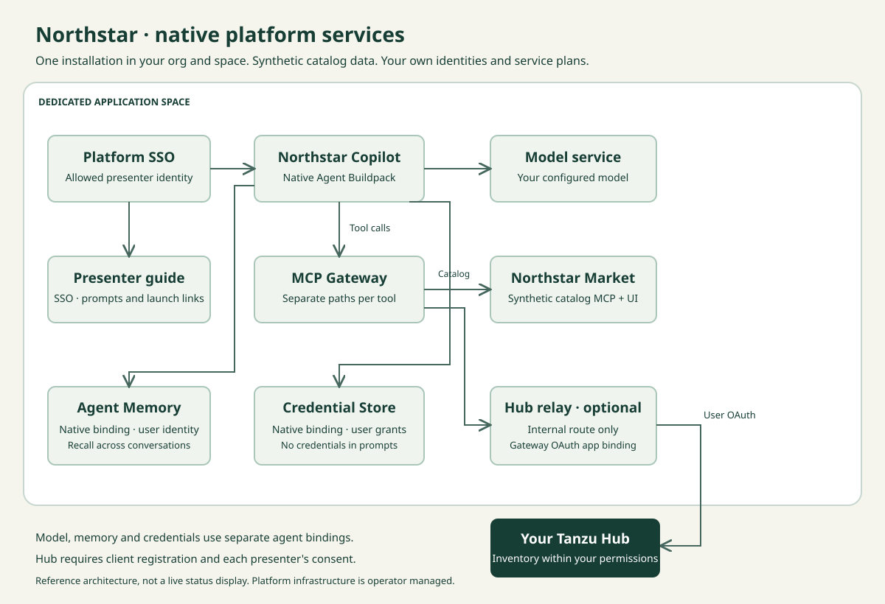

# Northstar Platform Demo

A small market that demonstrates a native Tanzu Platform agent: a real catalog tool call, memory across conversations, and an optional user-scoped Tanzu Hub inventory connection.

Bring your own compatible **Tanzu Platform 11** environment. This source kit includes the Market, presenter guide, agent instructions and SSO launcher, Hub relay, and deployment tooling. Your operator supplies Agent Buildpack, the model service, Platform SSO, MCP Gateway, Agent Memory and Credential Store.



## Run it in your environment

Start with the [deployment walkthrough](docs/deploy.md). It covers prerequisites, your own configuration, an offline plan, deployment, and a signed-in rehearsal.

```sh
git clone https://github.com/nkuhn-vmw/northstar-platform-demo.git
cd northstar-platform-demo
cp profiles/platform-11.example.json my-foundation.local.json
# Fill in your foundation, dedicated org/space, model and SSO values.
bin/demo --config my-foundation.local.json plan --phase 4 --json
bin/prepare
bin/verify
```

Before deployment, review the [current upstream proxy finding and operator decision](docs/verification.md#built-artifact-security-assessment).

The plan is local and does not log in or modify a foundation. Deployment requires the explicit `deploy --apply` command, a matching CF target, and successful preflight checks.

## Present the story

1. Ask Copilot for Produce products and compare its tool result with the storefront.
2. Save a harmless, unique marker with native Agent Memory. Start a blank conversation and retrieve it as the same user.
3. Optionally [connect Tanzu Hub](docs/hub-oauth.md). Save your user-scoped grant in Credential Store, then request a read-only application inventory for your org and space.

Phase 4 deploys the SSO-protected presenter guide at `https://<prefix>-guide.<apps-domain>/`. It includes prompts, launch links, connection instructions and the architecture diagram. Read the [presenter checklist](docs/present.md) before sharing it. The storefront uses synthetic data; it is not an ordering or payment service.

| Phase | Added capability |
| --- | --- |
| 1 | Native agent, configured model and SSO admission |
| 2 | MCP Gateway and Market catalog tools |
| 3 | Native Agent Memory and Credential Store; optional Hub |
| 4 | Customer branding and the presenter guide |

Each phase includes the dependencies of earlier phases. The default is one installation in an existing dedicated space. No platform tiles, roles or shared identity-provider clients are installed or modified by this kit.

## Build and maintain

Use Python 3.9+, Go **1.27.4+**, Java **21**, Git, Bash 4+, curl and jq. The checked-in Gradle wrapper downloads the pinned Gradle distribution; Maven and npm are not required. See [development and verification](docs/development.md), [runtime contracts](runtime/CONTRACT.md), [safe cleanup](docs/reset.md), and [security policy](SECURITY.md).

Source builds and external release downloads are pinned in [the dependency ledger](provenance/dependencies.json). The build targets Linux/amd64 for the CF application artifacts. Service/buildpack versions and availability must be checked on your target; this kit does not pin your platform's native agent runtime.

Licensed under [Apache-2.0](LICENSE), with [third-party notices](NOTICE) and [source provenance](provenance/SOURCES.md). Product imagery is documented in [the asset record](apps/market/ASSET-PROVENANCE.md). See [release verification](docs/verification.md) for what has actually been tested.
